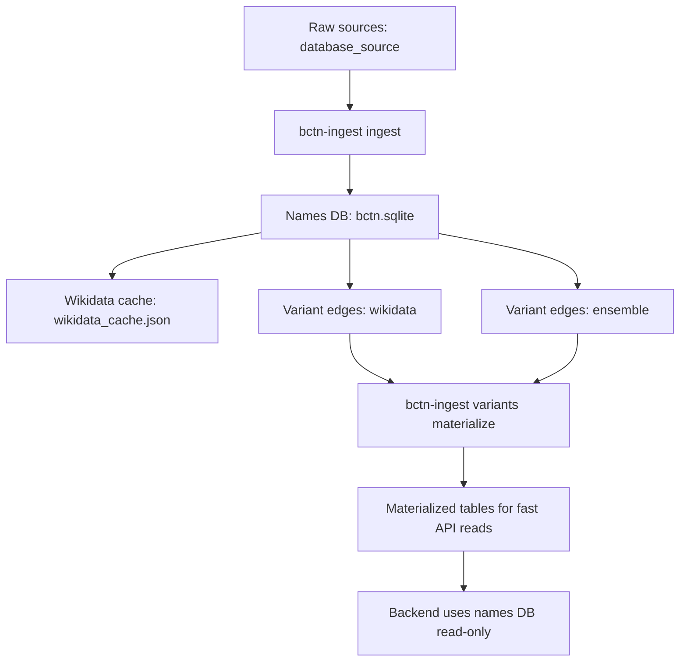
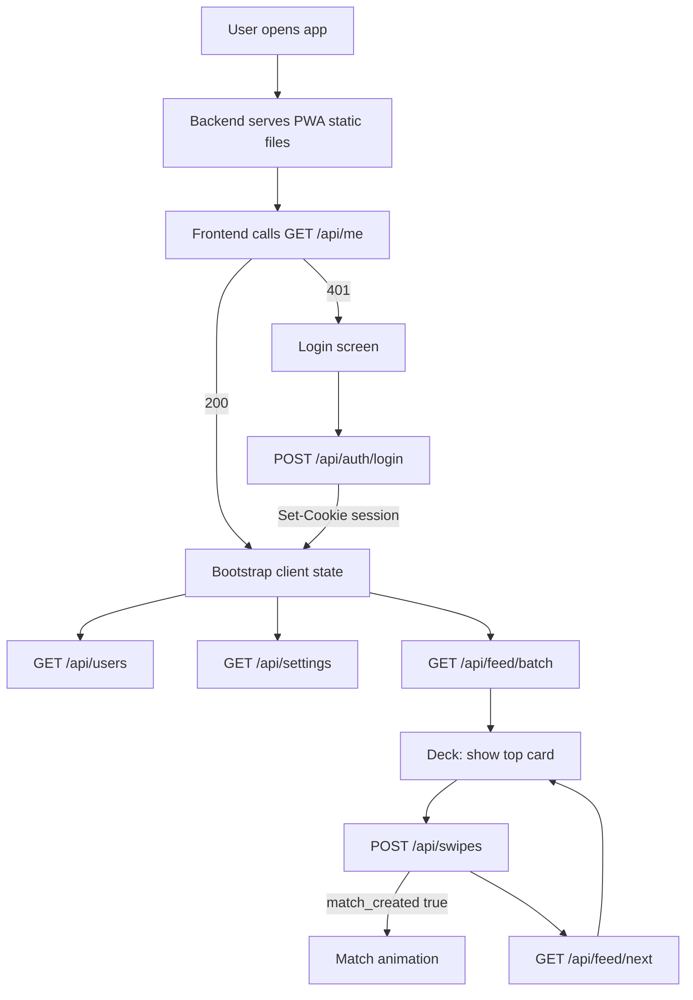
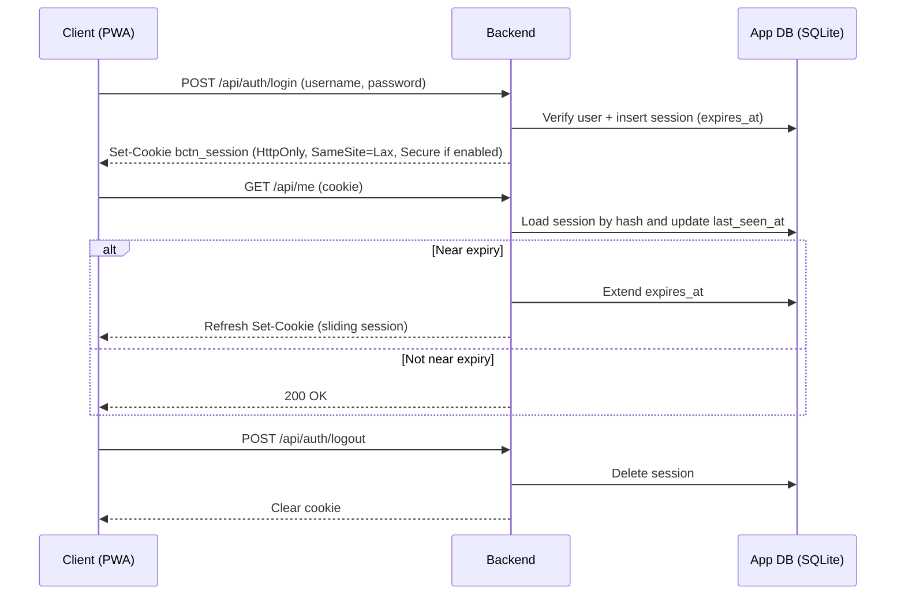
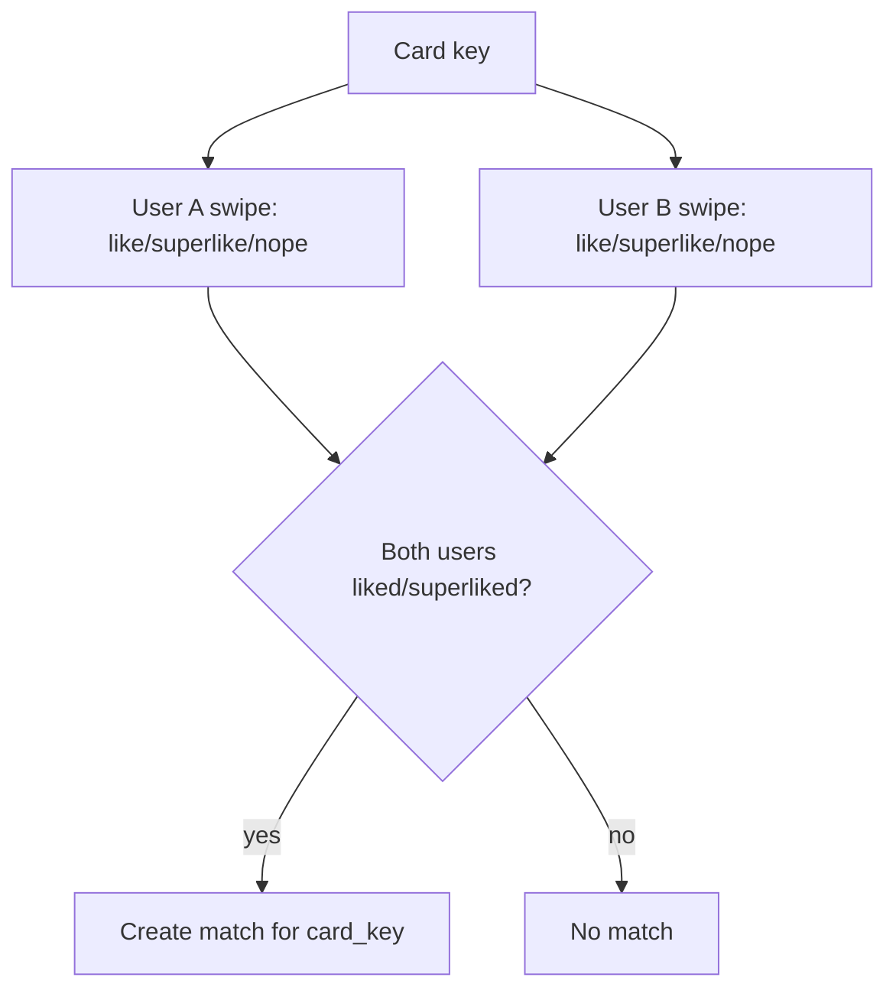
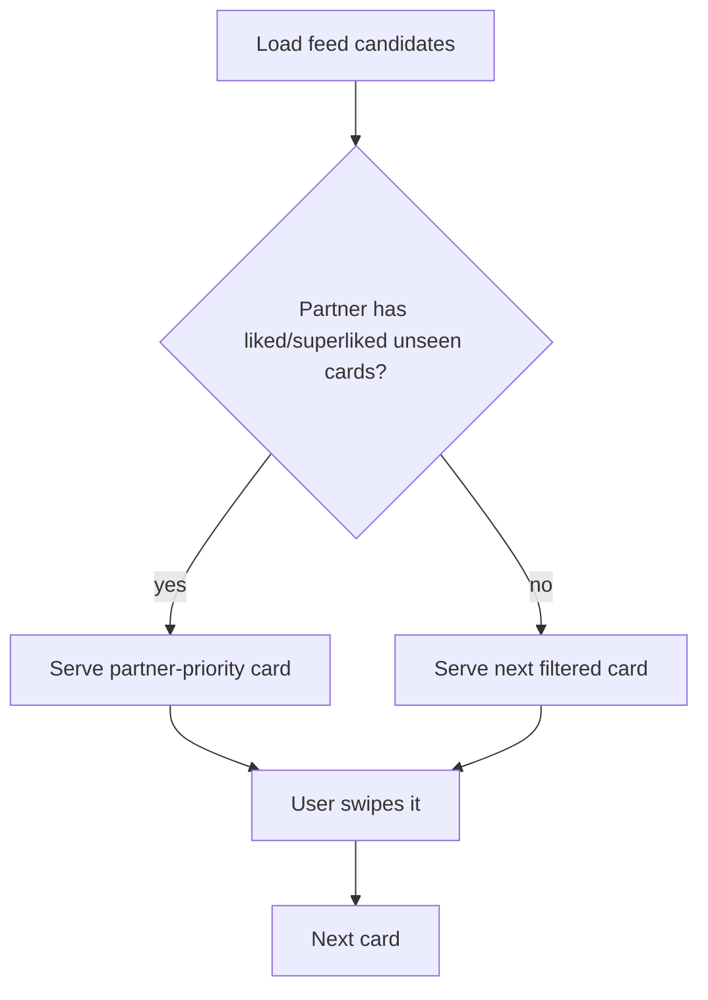
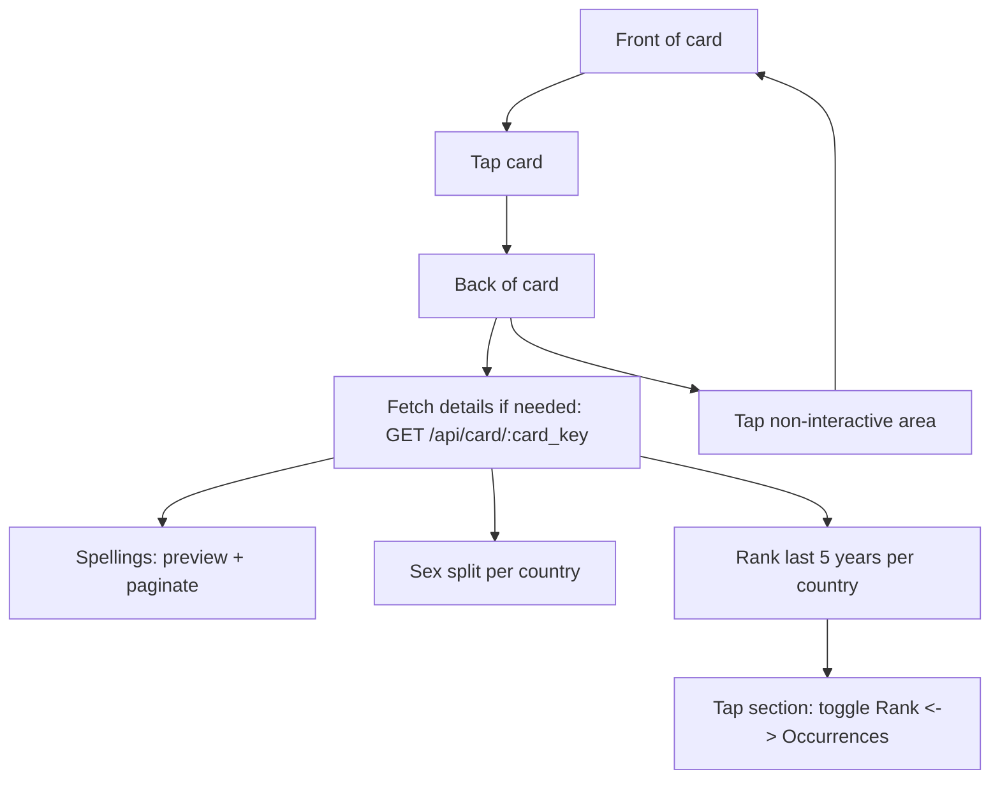
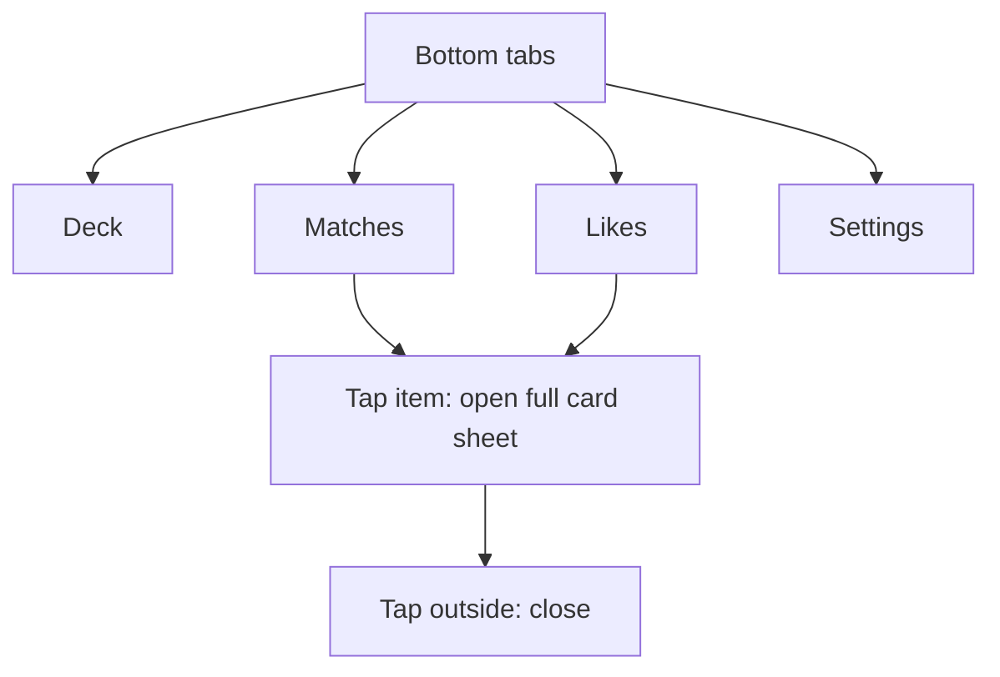
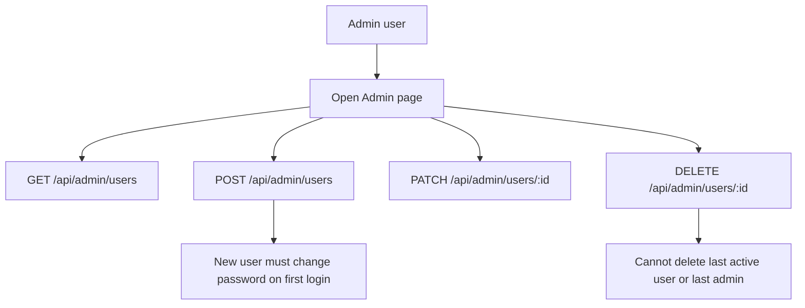

# App Workflow

This document maps the end-to-end workflow of BCTN from data ingestion to day-to-day app usage.

## Overview

Two SQLite databases are involved:

- Names DB (read-only): generated by `bctn-ingest`, then baked into the Docker image or used locally.
- App DB (read-write): created at runtime by the backend; stores accounts, sessions, swipes, matches, and settings.

## Data Workflow (names DB)

### Typical commands

- Full rebuild: `bctn-ingest rebuild-all` (recommended)
- If you run steps manually: ensure you run `bctn-ingest variants materialize` at the end

## Runtime Workflow (backend + PWA)

## Auth and session lifecycle

## Card model and matching

The app presents either:

- a group card (variant group), or
- a concept card (fallback when no group exists).

Swipes and matches are keyed by `card_key`.

## Partner-priority cards

If your partner liked or super-liked a card, that card is surfaced on top of your deck regardless of your current filters, and it stays until you swipe it.

## Card details view (front/back)

## Pages

## Admin workflow (two accounts)

The system enforces a hard cap of two total users (DB trigger).

