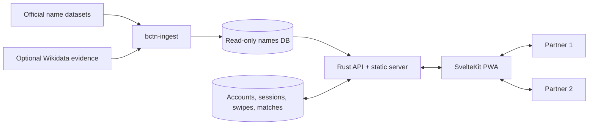

# BCTN

BCTN is a self-hosted, two-user baby-name app: think Tinder, but for choosing a
baby name together. You and your partner each swipe through name cards (nope /
like / super-like), and when you both like the same name, it becomes a **match**.
Flip any card for spelling variants, popularity over time by country, and a
male/female split.

Under the hood:

- A **read-only names database** (SQLite) generated from official sources and enrichment logic.
- A **read-write app database** (SQLite) storing accounts, sessions, swipes, and matches.
- A **Rust backend** that serves both the JSON API and the SvelteKit PWA.

## Why BCTN Is Technically Interesting

BCTN is more than a swipe interface over a list of names:

- **Data pipeline:** the Rust ingestion workspace normalises official national
  datasets, enriches spelling relationships with optional Wikidata evidence,
  scores variant-group candidates, and materialises app-facing card tables.
- **Two-database design:** the generated names catalogue stays immutable at
  runtime, while private user state lives in a separate migrated SQLite
  database. The catalogue can be rebuilt without touching accounts or swipes.
- **Purpose-built ranking:** deck selection combines country, popularity, and
  gender filters with randomisation, partner-liked prioritisation, and an
  optional cross-country “Best Picks” score.
- **Small deployment surface:** one Rust process serves the authenticated JSON
  API and the pre-built SvelteKit PWA, backed by two local SQLite files.
- **Deliberately constrained security model:** exactly two accounts, HttpOnly
  sessions, forced first-login password changes, host validation, and explicit
  trusted-proxy configuration.



Documentation:

- Product decisions: `@docs/PRODUCT_DECISIONS.md`
- Scoring system (optional “Best Picks” mode): `@docs/SCORING.md`

## How To Use The App

This app is designed for exactly two users (you and your partner). You both swipe through the same pool of name “cards” and the app highlights the overlap (matches).

### What you are swiping

Each swipe is recorded against a `card_key` in the **app DB**.

There are two kinds of cards:

- **Group card**: a curated “variant group” that links multiple concepts/spellings that are likely the same underlying given name.
- **Concept card**: a single “name concept” (the default when no group exists).

In practice:

- If a variant group exists for a name, you will typically see the **group card**.
- If no group exists, you will see a **concept card**.

### Swiping and matches

On the Deck page:

- **Nope**: you do not like this name.
- **Like**: you like this name.
- **Super-like**: a stronger “like” signal (same matching behavior; mainly UX priority).
- **Undo**: revert your last swipe.

A **match** is created when both users have a `like` or `superlike` recorded for the same `card_key`.

Partner-priority behavior:

- If your partner already liked/super-liked a name, those cards are surfaced to the top of your deck and marked visually so you know you are swiping your partner’s picks.

### Card details (front/back)

Tap a card to flip it. The back shows:

- **Spellings**:
  - A preview of common spellings.
  - A “See all” mode with pagination controls (page 1/2/3…).
- **Sex split per country**:
  - A simple slider visualization showing Male/Female distribution.
- **Popularity over time** (per country):
  - Each country shows its latest 5 years available (datasets don’t necessarily end the same year).
  - Tap the ranking section to toggle between **Rank** and **Occurrences** for those years.

### Likes, Super-likes, Matches

- **Likes**: the list of names you liked.
- **Super-likes**: the list of names you super-liked.
- **Matches**: names you both liked/super-liked.

Tapping an entry opens the full card (front/back) in an in-place sheet.

### Settings

Settings allow you to control what appears in your deck:

- **Countries**: choose which country datasets matter for labels and filtering.
- **Popularity tiers**: you can select multiple tiers at once.
- **Gender**: filters apply with “ANY selected country passes” semantics.
- **Best Pick mode**: switches the app to use the scoring described in `@docs/SCORING.md`.
- **Log out**: removes your local session and returns to the login screen.

### Admin and accounts

The app is intentionally minimal:

- Exactly **two accounts total** (enforced by the DB).
- Admin can create/modify/delete accounts from the Admin page.
- New users are prompted to set a new password on first login.

## Typical first run

1) Bootstrap the first admin user (one-time, server exits after bootstrap).
2) Start the server normally.
3) Log in as admin and create the second user.
4) Log in on both phones, swipe normally, then check the Matches tab.

## Quick Start (local)

Prereqs:

- Rust toolchain
- Node.js + `pnpm` (frontend build)

1) Build the names DB (first time or after ingestion changes):

```sh
# Full rebuild (re-ingest + Wikidata cache usage + ensemble auto-accept + materialize)
cargo run -p bctn-ingest --release -- rebuild-all \
  --out data/bctn.sqlite \
  --max-concepts 10000 \
  --cache-path data/wikidata_cache.json \
  --min-ensemble-score 0.90
```

2) Build the web UI and run the backend:

```sh
pnpm -C web build

# Local HTTP dev: Secure cookies must be disabled
BCTN_COOKIE_SECURE=false cargo run -p bctn-backend --release
```

3) Open `http://localhost:2286` (or your LAN host if you run on a server).

First user bootstrap:

- If the app DB has **0 users**, you must bootstrap an admin user once (see “Environment” below).

## Architecture (high level)

**Repositories / packages**

- `ingestion/` (`bctn-ingest`): builds `data/bctn.sqlite` (names DB)
- `backend/` (`bctn` binary): serves API + static PWA; uses both SQLite DBs
- `web/`: SvelteKit SPA (built to `web/build` for the backend to serve)

**Two SQLite databases**

- Names DB (read-only): default `data/bctn.sqlite`
  - Concepts, observations, variant edges, and materialized “card” tables for fast API reads.
- App DB (read-write): default `data/bctn_app.sqlite`
  - Accounts, sessions, swipes, matches, settings (see `backend/migrations/`).

## Environment

The backend reads `.env` automatically (via dotenv), but in production you typically set values via docker-compose.

Required / common:

- `BCTN_APP_DB`: path to the app DB (read-write)
- `BCTN_NAMES_DB`: path to the names DB (read-only)
- `BCTN_STATIC_DIR`: directory containing the built PWA (`web/build`)
- `BCTN_COOKIE_SECURE`: set to `true` behind HTTPS (Secure cookies)
- `BCTN_PUBLIC_HOST`: optional hardening; lock requests to a single host (e.g. `bctn.example.com`)
- `BCTN_TRUST_PROXY_HEADERS`: set to `true` only behind a trusted reverse proxy that sanitizes forwarded headers
- `BCTN_PROXY_HEADER_SECRET`: required when `BCTN_TRUST_PROXY_HEADERS=true`; must match `X-BCTN-Proxy-Secret`

One-time admin bootstrap (optional but required for an empty app DB):

- `BCTN_BOOTSTRAP_ADMIN_USERNAME`
- `BCTN_BOOTSTRAP_ADMIN_PASSWORD` (min 8 chars)

Bootstrap behavior:

- When bootstrap vars are set, the server creates the first admin user **only if there are 0 users**, logs `bootstrap_admin_done`, and exits.
- After bootstrapping, remove these variables and start the server normally.

Example `.env` template: `.env.example`

## Logging

The backend logs to stdout/stderr (so `docker compose logs` shows everything).

The main knob is `RUST_LOG` (see `.env.example` for presets). Common values:

- Normal (recommended): `RUST_LOG=info,tower_http=info,sqlx=warn`
- Quiet (less SQL noise): `RUST_LOG=info,tower_http=info,sqlx=error`
- Troubleshooting (very verbose): `RUST_LOG=debug,tower_http=info,sqlx=warn`

## Security Maintenance Checks

Run the dependency/security guard script before shipping security-maintenance changes:

```sh
./scripts/security_dependency_guard.sh
```

## Running in Docker (production-like)

This repo includes a distroless Docker build that bakes the names DB into the image and bind-mounts the app DB directory.

Key points:

- Names DB is baked into the image at `/app/data/bctn.sqlite` (read-only).
- App DB is expected at `/data/bctn_app.sqlite` (bind-mounted, read-write).
- Backend listens on `0.0.0.0:2286`.

Typical workflow:

```sh
docker compose up -d
docker compose logs -f
```

If you see `unable to open database file` for `/data/bctn_app.sqlite`, it’s a host filesystem permissions issue:

```sh
mkdir -p data
sudo chown -R 1000:1000 data
```

## Ingestion: building the names DB

### Full rebuild (recommended)

This produces a names DB ready for the app (including materialized card tables for fast API reads):

```sh
cargo run -p bctn-ingest --release -- rebuild-all \
  --out data/bctn.sqlite \
  --max-concepts 10000 \
  --cache-path data/wikidata_cache.json \
  --min-ensemble-score 0.90
```

Notes:

- Wikidata caching is stored at `data/wikidata_cache.json`.
- Ensemble edges above the threshold are auto-accepted; lower scores remain ignored/proposed.

### Browse/search (CLI)

```sh
# search by folded key (case/accents/apostrophes folded; hyphens preserved)
cargo run -p bctn-ingest --release -- search jose

# substring search (slower)
cargo run -p bctn-ingest --release -- search --contains allah

# show a concept (term is folded to a concept key)
cargo run -p bctn-ingest --release -- show abdallah

# top names by country/year
cargo run -p bctn-ingest --release -- top --country US --year 2024 --limit 25
```

### Wikidata variant edges (optional/manual)

```sh
cargo run -p bctn-ingest --release -- variants build \
  --db data/bctn.sqlite \
  --max-concepts 1000 \
  --batch-size 50 \
  --request-sleep-ms 500
```

### Ensemble scoring (optional/manual)

```sh
cargo run -p bctn-ingest --release -- variants build-ensemble --db data/bctn.sqlite --country ALL
```

### Materialize (required for the app)

If you did manual steps instead of `rebuild-all`, you still need to materialize:

```sh
cargo run -p bctn-ingest --release -- variants materialize --db data/bctn.sqlite
```

## Development

### Frontend

```sh
pnpm -C web dev
```

Static build for the backend:

```sh
pnpm -C web build
```

Checks:

```sh
pnpm -C web format
pnpm -C web lint
pnpm -C web check
```

### Backend

```sh
cargo run -p bctn-backend
```

Checks:

```sh
cargo fmt
cargo check
cargo clippy --all-targets --all-features -- -D warnings
cargo test
```

## API Overview

Authentication is cookie-based (HttpOnly session cookie). Key routes:

- Auth: `POST /api/auth/login`, `POST /api/auth/logout`, `POST /api/auth/change-password`, `GET /api/me`
- Feed: `GET /api/feed/next`, `GET /api/feed/batch`
- Swipes: `POST /api/swipes`, `POST /api/swipes/undo`
- Views: `GET /api/likes`, `GET /api/superlikes`, `GET /api/matches`
- Card details: `GET /api/card/:card_key`
- Settings: `GET/PATCH /api/settings`
- Admin: `GET/POST/PATCH/DELETE /api/admin/users...` (admin only)

## Security Notes (deployment)

If exposing publicly behind a reverse proxy:

- Set `BCTN_COOKIE_SECURE=true`.
- Set `BCTN_PUBLIC_HOST` to your public domain to reject unexpected Host headers.
- Ensure your reverse proxy overwrites/sanitizes `X-Forwarded-For` / `X-Forwarded-Host`.
- Consider adding proxy-level rate limiting on `POST /api/auth/login`.

## Troubleshooting

**Backend says: “run `bctn-ingest variants materialize`”**

- Your names DB is missing the materialized tables required by the app. Run:
  - `cargo run -p bctn-ingest --release -- variants materialize --db data/bctn.sqlite`

**Docker: `(code: 14) unable to open database file`**

- The bind-mounted `./data` directory isn’t writable by the container user. Fix ownership/permissions (see Docker section).
